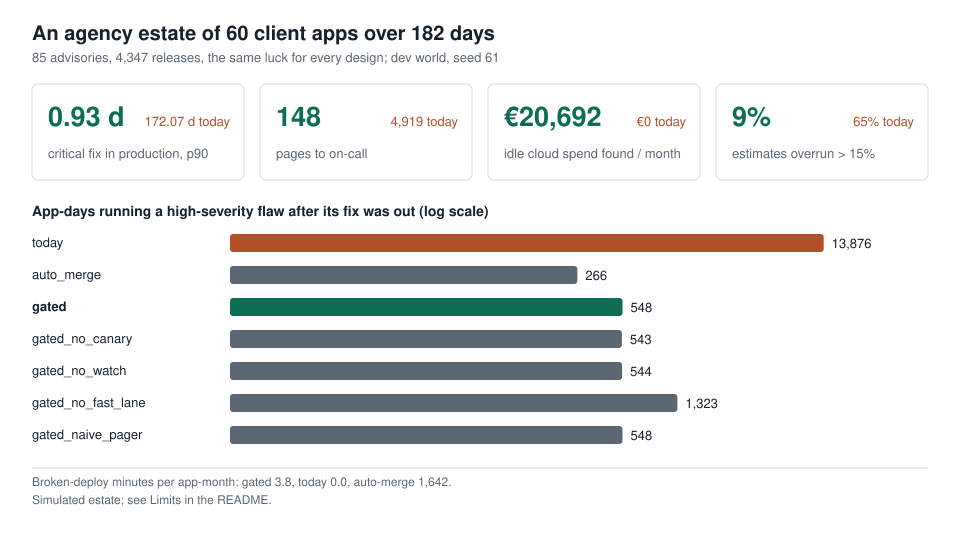
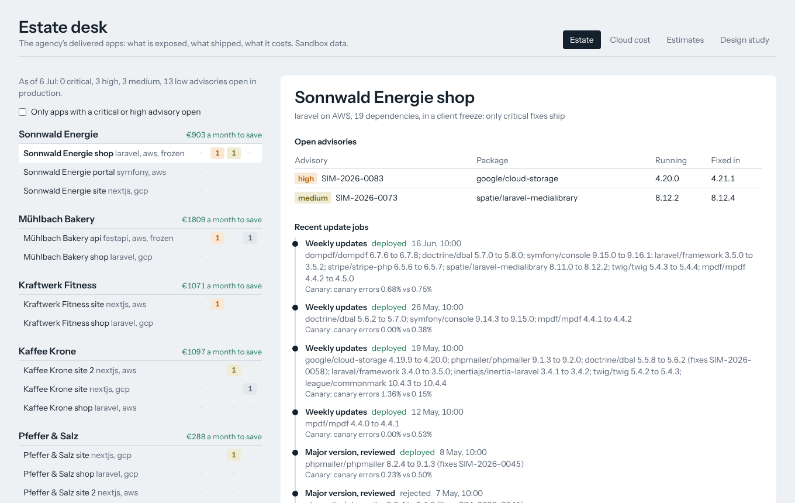
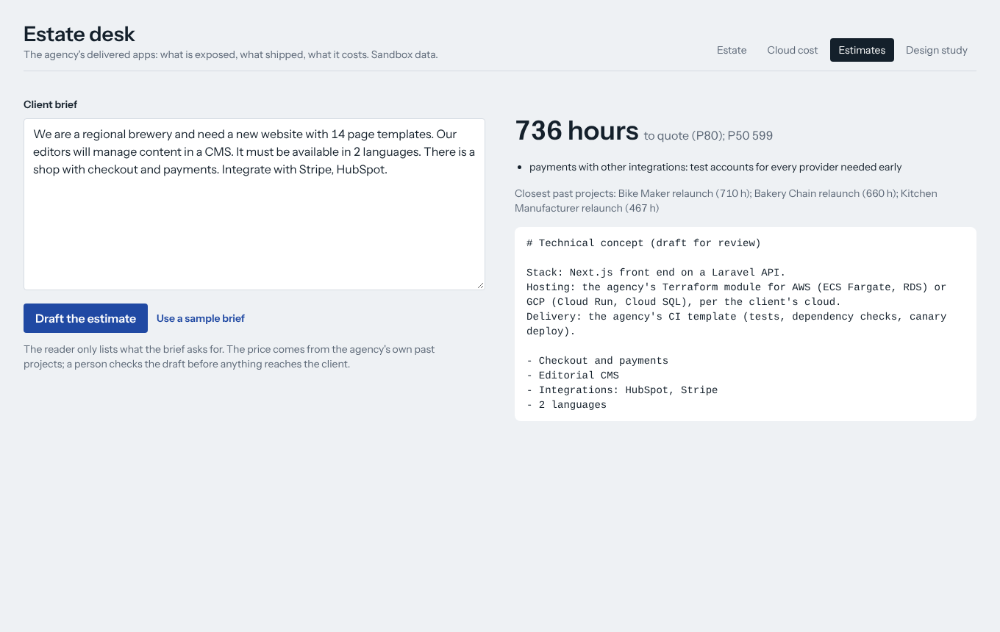
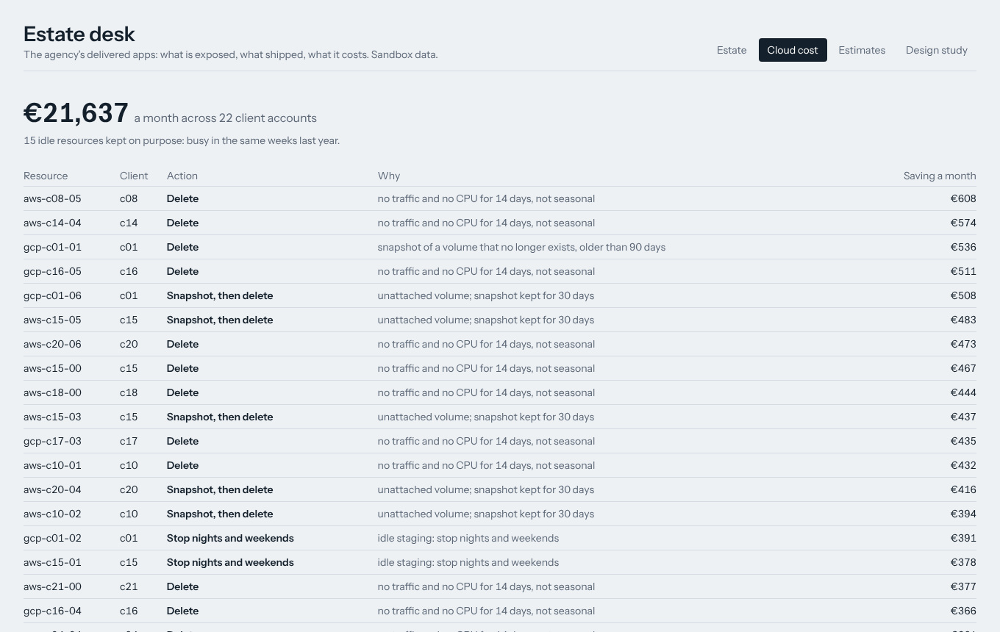
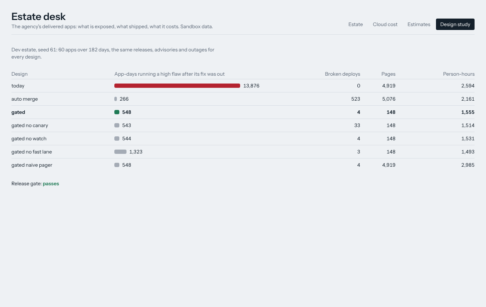

# client-estate-ops

An ops platform for an agency's delivered client estate: dozens of PHP, Python and Node apps on AWS and GCP that
were built for clients, went live, and now need security fixes, dependency updates, uptime and cost control without
a person patching each one by hand.

- **Advisories to fixes.** OSV advisories are matched against every app's lock files (Packagist, PyPI and npm
  version rules, including PEP 440). Critical and high fixes go out the same day as the smallest version that fixes
  them; routine updates go out weekly once a release is five days old; new major versions wait for a person, on a
  weekly budget; a client's campaign freeze holds everything but critical fixes.
- **Deploys that roll themselves back.** Every update runs the client's tests, then a canary on 10% of traffic
  judged by an error-rate test that is exact on quiet sites, then a six-hour watch after the full rollout.
- **Paging that means something.** An app is paged on only when two regions fail twice in a row; a failure right
  after a deploy rolls the deploy back instead of waking someone.
- **Cloud cost per client.** Idle and oversized resources across client accounts, with guards for seasonal
  campaign sites, staging, detached volumes and spiky machines.
- **Estimates agent.** Drafts a technical concept and an estimate from a client brief, priced from the agency's own
  past projects, with the questions to ask the client first; a person approves every draft.

The core is framework-free PHP 8.3 (`estate/`); the estimator is Python with FastAPI (`estimator/`); the console is
React and TypeScript (`web/`); Terraform modules for AWS, GCP and Debian hosts and CI templates for GitLab and GitHub
are in `infra/` and `ci-templates/`. Every number below comes from a simulated estate with its own truth (`lab/`):
each design is played through the same 182 days and scored against what really happened.

> Built in my own time as a portfolio project for the wongdoody Senior Backend Engineer / DevOps role. The estate,
> its clients, releases and advisories are simulated (advisory ids start with SIM-). See [Limits](#limits).

## Results

<!-- dashboard:start (generated by `make readme`; do not edit by hand) -->


**Dev estate** (seed 61): 22 clients, 60 delivered apps (14 django, 3 fastapi, 20 laravel, 20 nextjs, 3 symfony), 1,544 dependencies on 120 packages, 4,347 releases (118 with a regression), 85 advisories over 182 days. Every design saw the same releases, advisories, outages and probe blips.

| What the agency and its clients see | Today (people) | Gated estate platform |
|---|---:|---:|
| Critical advisories: p90 days in production after a fix existed | 172.07 | **0.93** |
| High advisories: app-days in production after a fix existed | 13,876 | **548** |
| Critical and high advisories still open at the end | 131 | **3** |
| Pages to on-call (share that were probe noise) | 4,919 (97%) | **148 (0%)** |
| Broken-deploy minutes per app-month (auto-merge bot: 1,642) | 0.0 | **3.8** |
| Person-hours on maintenance and on-call | 2,594 | **214** |
| Person-hours invested in major upgrades | 0 | **1,341** |
| Dependencies a major version behind at the end | 808 | **570** |
| Deploys during a client's campaign freeze (auto-merge bot: 814) | 0 | **13** (critical fixes only) |
| Idle cloud spend found per month, of €21,236 findable | €0 | **€20,692**, 0 wrong |
| Project estimates overrun by more than 15% | 65% | **9%** |

Today's process breaks nothing in this world because it updates once a month, by which time most bad releases have been fixed upstream; it pays for that with months of exposure on high advisories, a pager that is 97% noise and a growing pile of old major versions. The platform's own breakages are the price of patching within a day.

### The designs

| Design | What it does | Critical p90 days | High app-days | Broken deploys | Broken min / app-month | Pages (noise) | Person-hours | Majors behind |
|---|---|---:|---:|---:|---:|---:|---:|---:|
| today | people: a monthly patch day per client, critical fixes when someone reads about them, any failed probe pages | 172.07 | 13,876 | 0 | 0.0 | 4,919 (97%) | 2,594 | 808 |
| auto_merge | a bot merges every update the day it passes CI, majors included, freezes ignored | 0.93 | 266 | 523 | 1,642.2 | 5,076 (94%) | 2,161 | 28 |
| **gated** | fast lane for critical and high fixes, weekly routine updates aged 5 days, majors reviewed on a budget, canary, 6-hour watch, corroborated paging | 0.93 | 548 | 4 | 3.8 | 148 (0%) | 1,555 | 570 |
| gated_no_canary | ablation: no canary and no watch | 0.93 | 543 | 33 | 119.5 | 148 (0%) | 1,514 | 569 |
| gated_no_watch | ablation: canary but no post-rollout watch | 0.93 | 544 | 4 | 26.1 | 148 (0%) | 1,531 | 570 |
| gated_no_fast_lane | ablation: security fixes wait for the weekly run | 5.93 | 1,323 | 3 | 2.8 | 148 (0%) | 1,493 | 576 |
| gated_naive_pager | ablation: any failed probe pages | 0.93 | 548 | 4 | 3.8 | 4,919 (97%) | 2,985 | 570 |

In the gated design the canary ran 2,180 times and rolled back 29 broken updates (8 false alarms); the 6-hour watch caught 4 more that the canary missed (12 false alarms, each an hour of someone's time). On an average review day 299 majors wait for the budget of 8 reviews a week.

### Cloud cost across client accounts

| Method | Findings | Saving per month | Would remove something needed | What it would have removed |
|---|---:|---:|---:|---|
| no audit (today) | 0 | €0 | 0 | nothing |
| delete anything idle (common script) | 85 | €10,118 | 54 | 33 staging, 19 seasonal, 2 migrating |
| guarded audit | 109 | €20,692 | 0 | nothing |

Total spend €58,126 a month over 177 resources. Seasonal means a campaign site that is idle now and busy in the same weeks last year; migrating means a volume detached on purpose.

### Estimates from client briefs

| Who estimates | Median error | Overrun > 15% | Fixed-price margin lost | Quoted > 1.6× actual | Asked the client first | Person-hours |
|---|---:|---:|---:|---:|---:|---:|
| person alone (today) | 25% | 65% | €1,657,702 | 1% | 0 | 480 |
| agent without checks | 42% | 71% | €4,209,920 | 1% | 0 | 120 |
| agent with reference class and checks | 20% | 9% | €292,940 | 19% | 20 | 130 |

80 briefs. The agent quotes its P80 from the agency's own past projects, so it overruns rarely and over-quotes sometimes; a person approves every draft.

### Release gate (config/estate.json)

- ok critical advisories: p90 0.9 days exposed after a fix existed (max 3)
- ok broken-deploy minutes 3.8 per app-month (max 30)
- ok noise pages 0% (max 20%)
- ok cost findings that would remove something needed: 0 (max 0)
- ok estimates overrun by more than 15%: 9% (max 15%)

### Held-out estate (run once)

Seed 907: other clients, apps and luck, more Python and Node, 118 advisories, more probe blips and outages, and client briefs in phrasings the reader was never written against. See docs/heldout.md.

| | Dev today | Dev gated | Held-out today | Held-out gated |
|---|---:|---:|---:|---:|
| Critical p90 days exposed | 172.07 | 0.93 | 156.88 | 1.02 |
| High app-days exposed | 13,876 | 548 | 13,212 | 717 |
| Broken min / app-month | 0.0 | 3.8 | 0.0 | 3.0 |
| Pages (noise share) | 4,919 (97%) | 148 (0%) | 8,003 (97%) | 239 (0%) |
| Person-hours | 2,594 | 1,555 | 3,706 | 1,530 |
| Estimates overrun > 15% | 65% | 9% | 69% | 88% |
| Cost findings that would remove something needed | 0 | 0 | 0 | 0 |
| Gate | | pass | | **fail** |

- held-out FAIL estimates overrun by more than 15%: 88% (max 15%)

<!-- dashboard:end -->

### What the held-out estate showed

The platform held up on an estate it was never tuned on, with 39% more advisories and 60% more probe noise: critical
fixes reached production within a day at p90, high-severity exposure stayed at 5% of today's, broken-deploy minutes
stayed at 3 per app-month, not one page was noise, and no cost finding would have removed something needed.

The estimate agent did not. Its keyword reader was written against the dev phrasings and recognised almost nothing
in the new ones ("roughly 18 different layouts", "a private area for dealers"): 218 features misread across 80
briefs. Its checks did notice, and flagged all 80 briefs as needing answers from the client, so in use a person
would have taken over; but the study scores the number each draft carried, and 88% of those overran. That fails the
gate. The fix is in the reader (a model behind the same `Reader` interface, or rules written against real briefs),
and it needs a new held-out set to be measured: these phrasings are spent.

## How it works

```
 OSV feeds ──► /api/advisories ─┐                       ┌─► fast lane (critical, high): smallest fixing version, today
 lock files ──► inventory ──────┼─► Planner (PHP) ──────┼─► routine (Tuesday): newest same-major release aged 5 days
 registries ──► releases, yanks ┘   per app, per day    ├─► review: majors, 8 a week, security first
                                                        └─► held: client freeze, or no fix released yet
 job ─► client tests ─► canary 10% ─► CanaryJudge ─► rollout ─► 6 h watch ─► CanaryJudge ─► keep or roll back
 probes (3 regions) ─► Pager: 2 regions × 2 rounds ─► page, or roll back the deploy that just went out
 billing + metrics ─► Auditor: delete, snapshot-and-delete, schedule, downsize, or keep (seasonal, spiky, tagged)
 client brief ─► Reader proposes features ─► reference class prices P50/P80 ─► questions, risks, concept ─► a person
```

The lab drives every design through the same PHP code that serves the API, over JSON lines on stdio
(`estate/bin/estate serve-stdio`), so the study measures the product, not a copy of it.

Decisions and the alternatives that lost are in [docs/adr](docs/adr).

## Console

The estate desk (`web/`: React 19, Vite, Tailwind 4, Motion, TanStack Query) reads the API: every client's apps
worst-exposed first with one app's advisories, fixed versions, update jobs and canary verdicts beside them; the cost
findings; the estimate agent; and the design study.

| Estate | Estimates |
|---|---|
|  |  |
| **Cloud cost** | **Design study** |
|  |  |

## Run it

PHP 8.3 with PDO, Python 3.12, Node 22. Terraform 1.6+ (or OpenTofu) for the modules.

```sh
make check        # PHPUnit, PHPCS (PSR-12), PHPStan, lab and estimator tests, console tests, README in step
make study        # the dev estate through every design: reports/dev.json and the sandbox (about 3 minutes)
make readme       # regenerate the dashboard above and docs/dashboard.svg
make serve        # sandbox API on :8080 and estimator on :8090; the console with `cd web && npm run dev`
docker compose up # the same on PostgreSQL in containers
```

### API

| Route | What it does |
|---|---|
| `GET /api/estate` | every client and app: open advisories by severity, open jobs, incidents, freeze, monthly savings |
| `GET /api/apps/{id}` | one app: dependencies, exposures with fixed versions, update jobs, incidents |
| `GET /api/findings` | cloud cost findings with the saving and the reason |
| `POST /api/advisories` | ingest OSV advisories (bearer token) |
| `POST /api/apps/{id}/plan` | today's update plan for one app (bearer token) |
| `POST /api/canary/verdict` | promote, extend or roll back from baseline and canary counts (bearer token); the CI templates call this |
| `POST /api/cost/audit` | audit a list of resources (bearer token) |
| `POST /estimates` (estimator) | a draft concept and estimate for a brief |

## Limits

- The estate is simulated. Release cadences, regression and yank rates, how often a client's tests catch a break,
  how fast users report a subtle one, probe blips, outages and project effort are plausible assumptions, not
  measurements from an agency. The truth is written independently of the product and the product never sees it.
- Package names are real so the console reads like an estate; their versions, releases and advisories are not.
- The Terraform modules are formatted and validated in CI, not applied to real accounts. The GitLab template is
  checked by a linter in this repository, not run on GitLab.
- The estimate reader is keyword rules in English and German written against the dev phrasings; a model can
  replace it behind the same interface (`estimator/reader.py`), and the price never depends on its free text.
- Person-hours use fixed costs per activity (a page, a review, an incident); they compare designs, they are not a
  staffing plan.

## How this was built

Written with Claude Code. The scope, the invariants in [AGENTS.md](AGENTS.md) and the designs to compare came
first; the agent drafted code and tests under those rules, and every number in the dashboard is generated by the
commands above. The held-out estate was run once, after every choice was fixed on dev.
